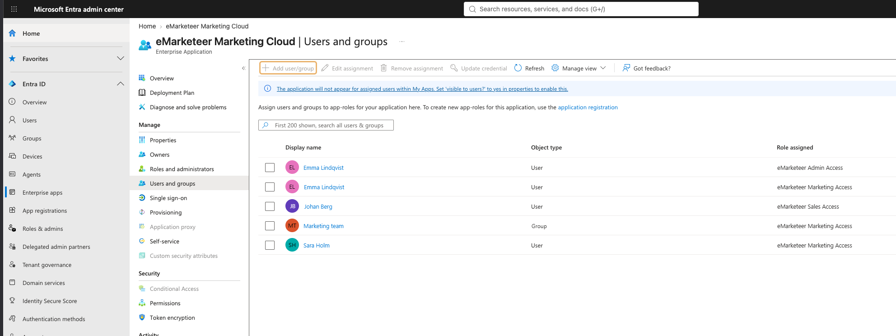

# How to enable SSO through Microsoft Entra

With single sign-on (SSO) through Microsoft Entra, your users sign in to eMarketeer with their Microsoft account.

The first time a user signs in, eMarketeer creates the user automatically. The app roles you assign in Entra decide the user's licenses and privileges in eMarketeer.

## Before you start

You need three details:

* **Your Microsoft Entra tenant ID.** You find it on the **Overview** page of Microsoft Entra ID.
* **Your email domain**, for example `nordvikmarketing.se`. Users with an email address on this domain sign in through Microsoft.
* **Your eMarketeer tenant ID.** In eMarketeer, click the gear icon at the top right. The ID is shown as **TenantID** under your account name.

## Enable SSO

1. Contact eMarketeer support with the three details. We let you know when SSO is enabled for your account.
2. An administrator in your eMarketeer account signs in to eMarketeer and accepts the prompt to allow the connection.

## Assign app roles

When the connection is allowed, the **eMarketeer Marketing Cloud** app is added to your Enterprise apps in Microsoft Entra. Assign users or groups to its app roles to give them access to eMarketeer.

1. In the Microsoft Entra admin center, go to **Entra ID** → **Enterprise apps** and open **eMarketeer Marketing Cloud**.
2. Open **Users and groups** and click **Add user/group**.
3. Select the users or groups, select a role, and click **Assign**.

A user can have several roles. Add one assignment for each role, or assign the roles to a group. For example, give a user both eMarketeer Marketing Access and eMarketeer Admin Access to make them a Marketing User with administrator privileges.

If you change a user's roles in Entra, the change applies in eMarketeer the next time the user signs in.

### The app roles

| Role | Value | What the user gets in eMarketeer |
| --- | --- | --- |
| eMarketeer Marketing Access | `em_marketing` | A Marketing User license: campaigns, emails, forms, contacts, Journeys and reports. |
| eMarketeer Sales Access | `em_sales` | A Sales User license: the Lead Board and leads. |
| eMarketeer Admin Access | `em_admin` | The Administrator privilege: account settings and user management. |
| eMarketeer Developer Access | `em_developer` | The Developer privilege: the full HTML source in the email editor, landing pages, apps and the JSON editor in forms. |
| eMarketeer CRM Panels Access | `em_crm_panels_access` | The CRM Web panels privilege: eMarketeer panels in your integrated CRM. |

See [User accounts](user-accounts.md) for more about user types and privileges.

## Sign in with SSO

Users sign in by entering their email address on the eMarketeer login page. If the address is on your email domain, eMarketeer sends them on to sign in with Microsoft.


Deleting a user in Microsoft Entra doesn't remove the user from eMarketeer, but the user can no longer sign in.

