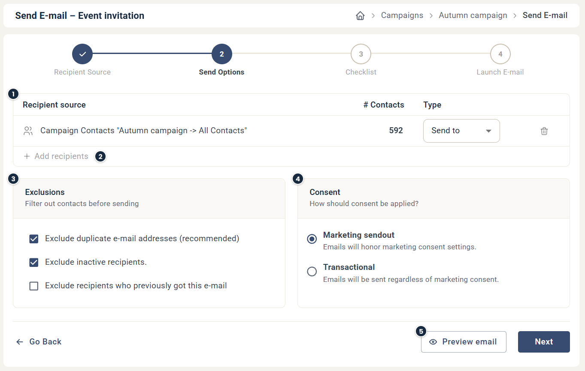

# Email send options

Send Options is step 2 when you send an email. It shows who the email goes to, and lets you filter out contacts before you send.

Most simple send-outs work with the default settings. Use the options here when you send to several recipient sources, send a reminder, or need to control consent.

## Recipient sources

Each recipient source you add creates its own row (1). The row shows the number of contacts in the source and its type:

* **Send to** sends the email to the contacts in the source.
* **Block** makes sure none of the contacts in the source get the email, even if they are also part of another recipient source. This is useful when you send reminders. See [How to send reminders](../../knowledge-base/email-content/configuring-reminder-email.md).

To remove a recipient source from the send-out, click the trash-can icon on its row.

To add more recipient sources, click **Add recipients** (2) below the list.

## Exclusions

Use the exclusions (3) to filter out contacts before you send. You can review the contacts that will be excluded on the next page, the checklist. See [Understanding the Email Checklist](../../knowledge-base/reports/checklist-explained.md).

* **Exclude duplicate e-mail addresses:** if the send-out includes several contacts with the same email address, only one of them gets the email. The same contact in several recipient sources is always counted as one contact.
* **Exclude inactive recipients:** leaves out contacts who have not interacted with your emails for over a year. See [Exclude inactive recipients](exclude-inactive-recipients.md).
* **Exclude recipients who previously got this e-mail:** if this email component has been sent before, the contacts who got an earlier send-out are blocked.

For example, you send the email to a list of 100 contacts. The next day, 5 new addresses are added to the list. Send the email to the full list of 105 with this box ticked, and the 100 contacts who already got the email are blocked.

## Consent

The consent setting (4) decides whether the send-out honours your contacts' marketing consent. **Marketing sendout** leaves out contacts who have withdrawn their marketing consent. **Transactional** sends the email regardless of marketing consent. See [Transactional sendouts](transactional-sendouts.md).


Always choose **Marketing sendout** unless the email is not a marketing email. Misusing **Transactional** harms your sender reputation.


## Preview email

Click **Preview email** (5) to preview the email for each added recipient. This is a good way to check that personalization works before you send.
