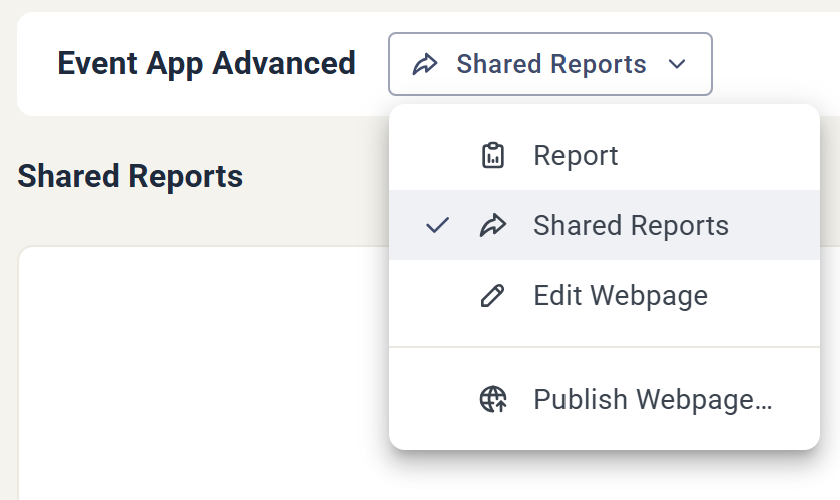
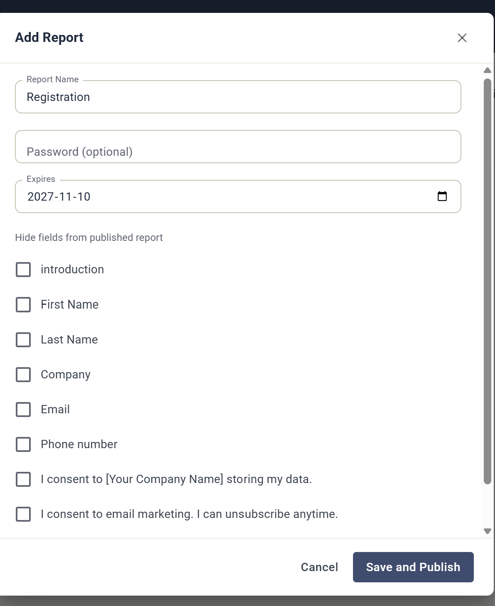

# Shared Reports

Shared Reports let you publish any component report as a shareable URL that anyone can open — no eMarketeer login needed.

A shared report stays live. It updates in real time as data comes in, so whoever you send it to always sees the current numbers. That makes it useful for things like a participation or catering list for an event, or for sharing the metrics of a newsletter sendout with a colleague or client.

A shared report mirrors the eMarketeer component report, but it is not fully interactive. For security, the actions you have inside the app are limited in the shared view.

## Create a shared report

Open the component, click the dropdown next to the component name, and choose **Shared Reports**.

In the Shared Reports view, click **Add Report**. Give the report a name, set any of the options below, and click **Save and Publish** to generate the URL.

## Sharing options

* **Password** — protect the report with a password, so only the people you give it to can open it. Optional.

A form component report adds two more options:

* **Hide fields** — leave specific fields and contact data (first name, last name, company, email, phone number, and so on) out of the published report.
* **Expires** — set a date when the shared report stops being available.
