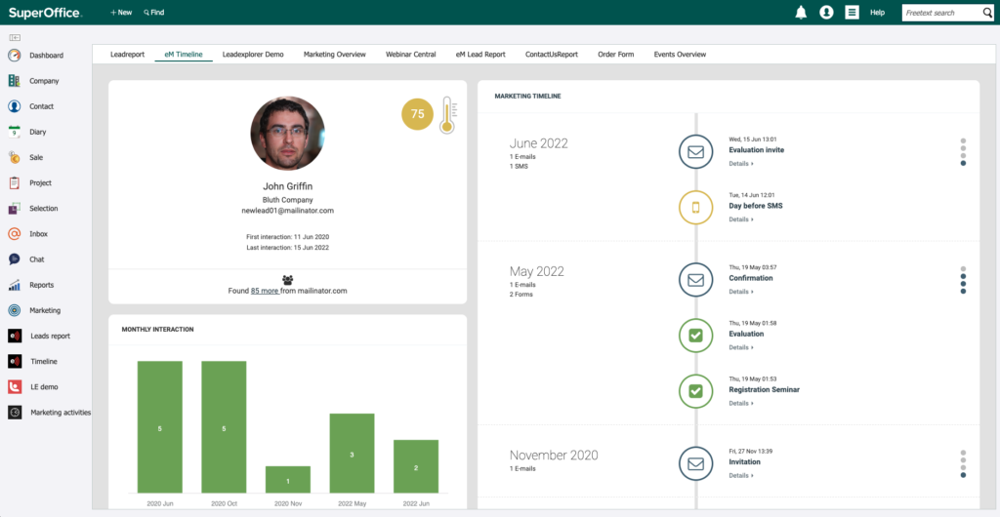
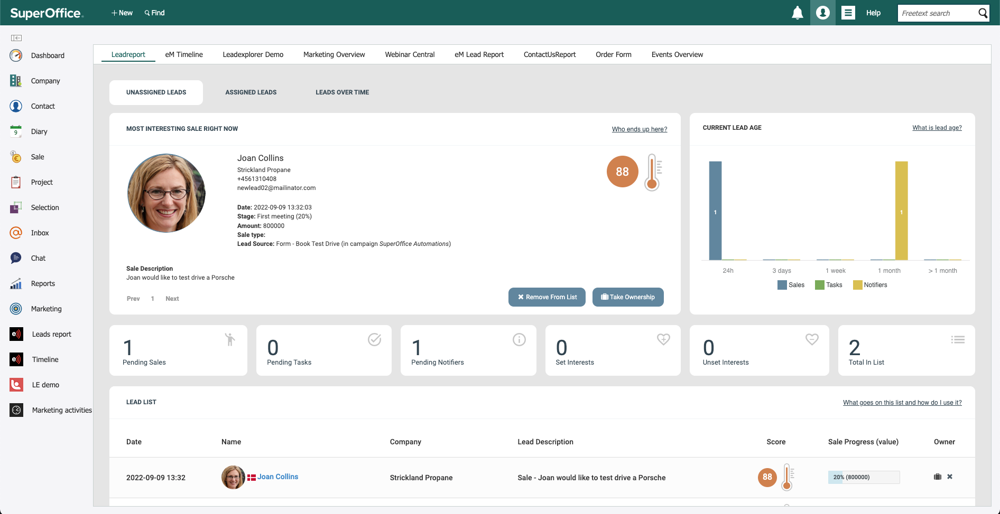

# The SuperOffice Integration - features and flows

The eMarketeer integration for SuperOffice CRM connects marketing activity to the CRM so sales sees lead and engagement data without manual handoffs.

## Common use cases

The integration is used from two perspectives: marketing (the eMarketeer side) and sales (the SuperOffice CRM side).

From a marketing perspective, the integration is most often used to:

* Import SuperOffice segments (selections) for addressing emails.
* Use automations to send events or create objects in SuperOffice CRM, such as:
  * Create a sale.
  * Create activities (pending or completed).
  * Add or remove contacts from selections or projects.
  * Add or remove interests.

From a sales perspective, the integration allows SuperOffice CRM users to:

* See information sent from eMarketeer about the contacts. The automations described above can create a sale, activity, or task in the CRM.
* Use the Automation Queue (a web panel) to screen new contacts from eMarketeer, and match them to existing contacts or create them in SuperOffice CRM.
* Get a full history of contact interactions with online content through eMarketeer's Timeline Report.

## Integration interface

eMarketeer connects to SuperOffice CRM using the standard NetServer services. eMarketeer currently uses version 7.5 for backward compatibility.

## Import and export of contacts

### Separate databases

eMarketeer and SuperOffice CRM have separate databases, and they stay separate even with the integration in place. There is no background synchronization of contacts. Contacts are linked through the External ID, see [How contacts are matched between eMarketeer and SuperOffice](superoffice-contact-matching.md). Contacts are only created by the integration in specific scenarios:

* **In SuperOffice CRM:** eMarketeer creates new contacts (and companies) in two ways:
  * **Automation Queue:** when an automation needs a contact that isn't in SuperOffice yet, the contact waits in the eMarketeer Automation Queue web panel. A SuperOffice user screens it there, and matches it to an existing contact or creates it. Because eMarketeer generates contacts from the web, this manual step makes sure only valid contacts reach SuperOffice CRM. See [How unmatched contacts are handled](../../knowledge-base/integrations/superoffice-automations-pro.md#how-unmatched-contacts-are-handled).
  * **Journeys:** the SuperOffice Journey steps can create missing contacts and companies automatically, if you allow it in the step settings. See [Creating missing contacts in SuperOffice](superoffice-contact-matching.md#creating-missing-contacts-in-superoffice).
* **In eMarketeer:** new contacts are created when you [import contacts from SuperOffice CRM](import-contacts-from-superoffice-crm.md). This is commonly done when sending an email to a SuperOffice selection or project.

### Fields

Contacts are transferred with a fixed set of standard fields, listed in [Import contacts from SuperOffice CRM](import-contacts-from-superoffice-crm.md#imported-fields). The same fields are filled when eMarketeer creates contacts in SuperOffice.

When eMarketeer creates companies in SuperOffice, these fields are filled on the company card:

* Company name
* Country
* Category
* Industry

There is no custom field mapping. Beyond the standard fields, automations can add or remove interests from contacts.

## Automations

When contacts interact with eMarketeer through emails, forms, apps, and so on, automations can perform tasks in both eMarketeer and SuperOffice CRM. They are triggered by actions such as link clicks, form submissions, and email opens.

When an automation runs, eMarketeer can perform the following actions in SuperOffice CRM:

* Create a new sale.
* Create a task (pending activity).
* Notify a sales representative (completed activity).
* Add or remove a contact from a selection or project.
* Add or remove an interest from a contact.

These activities have been added to SuperOffice by automations from eMarketeer.

## Web panels

Web panels show more information or extend eMarketeer features into SuperOffice CRM. They can be shown or hidden based on the SuperOffice user's group. The following web panels are used in SuperOffice to interact with eMarketeer.

* The Automation Queue. Lists contacts whose automations are waiting for a match in SuperOffice. For example, an automation that creates a sale can only run when the contact exists in SuperOffice. Until then, the contact waits in the Automation Queue, where sales matches it to an existing contact or creates it.
* The Timeline Report. A web panel on the contact card in SuperOffice CRM. It shows every interaction the contact had with eMarketeer marketing content, including emails, forms, SMS, and landing pages.
* Event details. When eMarketeer creates a sale or an activity, this panel shows the event that triggered it.

Learn more about your contacts and how they engaged with your marketing content.

This is where all contacts that are not yet in SuperOffice are listed.

## Legal Basis (GDPR)

eMarketeer has its own system for storing legal basis (contact consents and so on). When integrated with SuperOffice Online, legal basis is synced automatically between the systems. For on-premise installations of SuperOffice, there is no sync service, but you can access the eMarketeer legal basis database via API.
