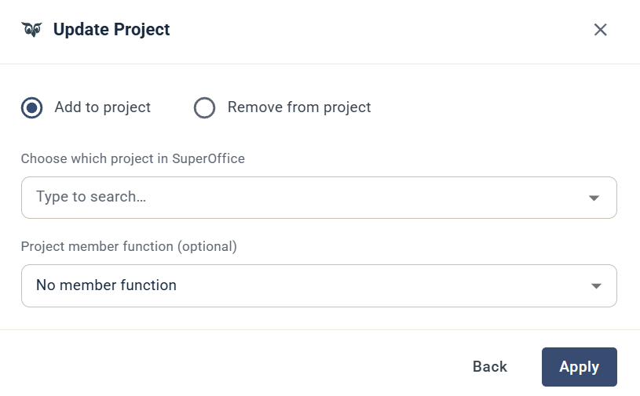

# Add / Remove from project

## Settings

The step opens the **Update Project** dialog. Choose **Add to project** or **Remove from project**.

**Choose which project in SuperOffice:** Search for a project in your connected SuperOffice account and select it.

**Project member function (optional):** Only for **Add to project**. Sets the contact's function in the project, for example Invited, Registered or Attended. You choose from the functions set up for the project in SuperOffice. If you leave it at **No member function**, the contact's function is not changed. If the contact is already in the project, the function is updated. Later steps in the Journey can then move the contact from Invited to Registered to Attended.
