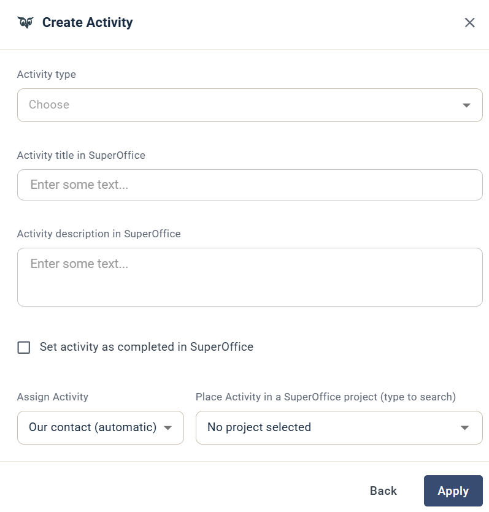

# Create activity

## Settings

**Activity type:** Sets the activity type. Choose from the available activity types in your connected SuperOffice account.

**Activity title in SuperOffice:** The title of the activity. It is saved in the activity's **Title** field in SuperOffice. Type @ to insert personalized merge fields. The title is required.

**Activity description in SuperOffice:** A description for the activity. It is saved in the activity's **Agenda** field in SuperOffice. Type @ to insert personalized merge fields.

**Set activity as completed in SuperOffice:** Toggle whether the activity is created as completed. An uncompleted activity is more visible to the assigned SuperOffice user.

**Assign Activity:** Assign the activity to a specific SuperOffice user, or use the dynamic **Our contact** option. Our contact is the user assigned to the contact's company under the Our contact field on the SuperOffice company card.

**Place Activity in a SuperOffice project:** Assign a project to add both the activity and the contact to a SuperOffice project of your choice.
