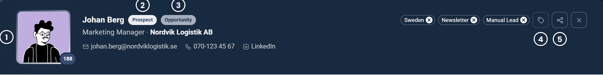
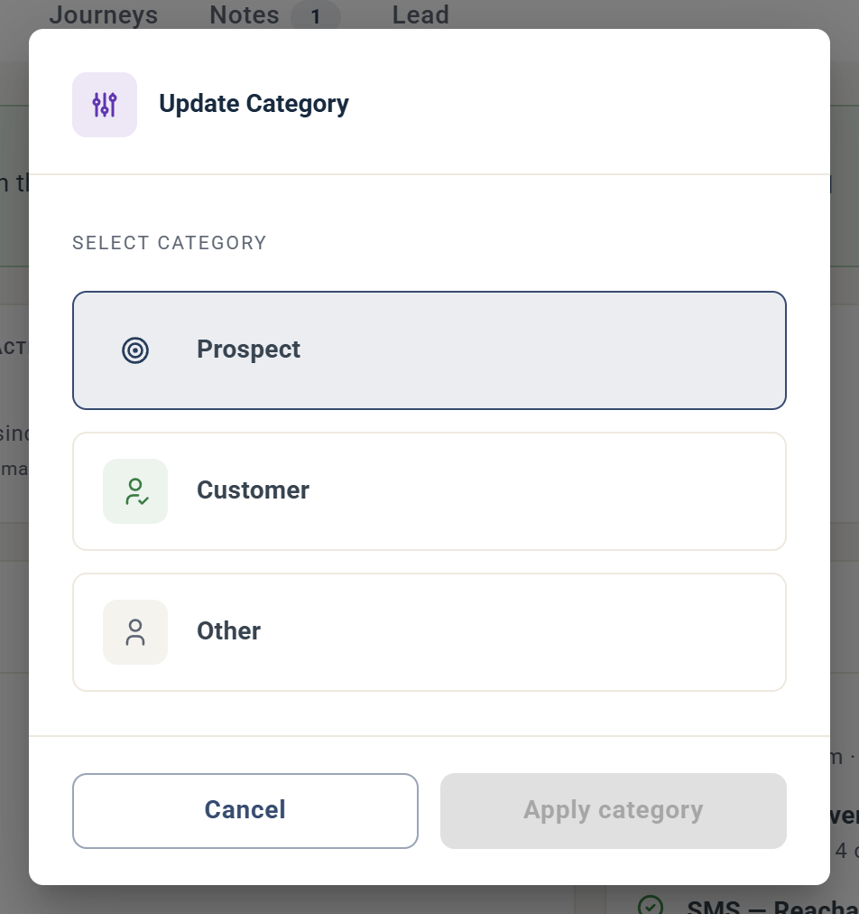
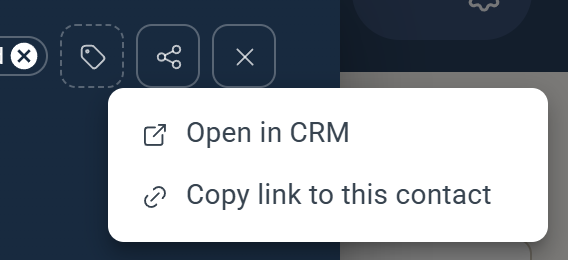
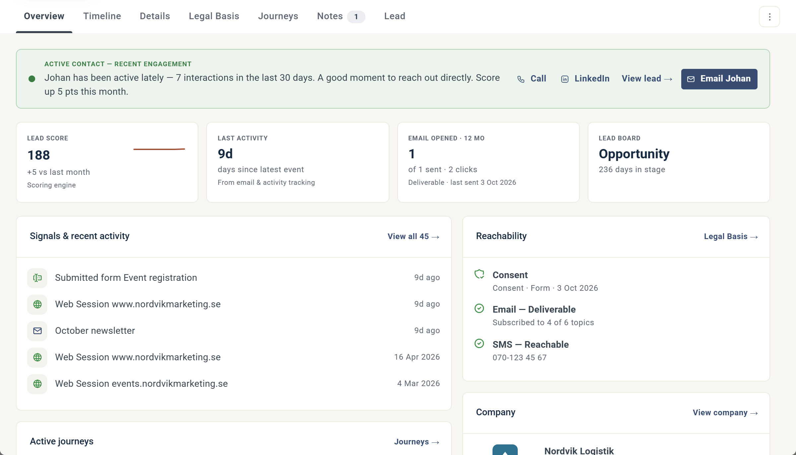
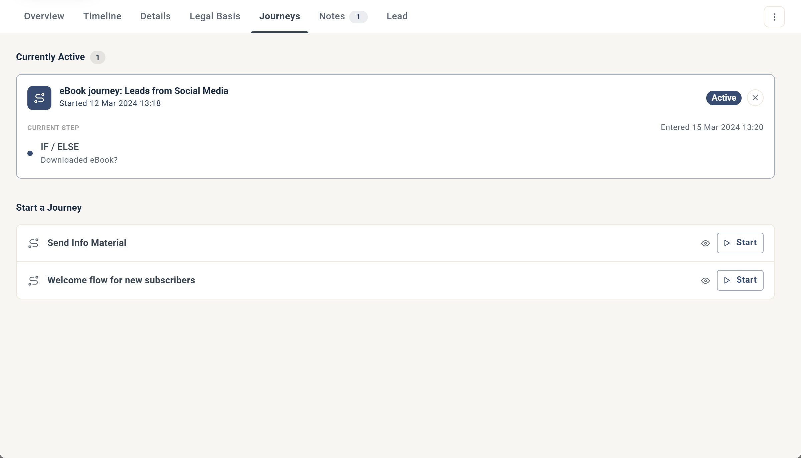
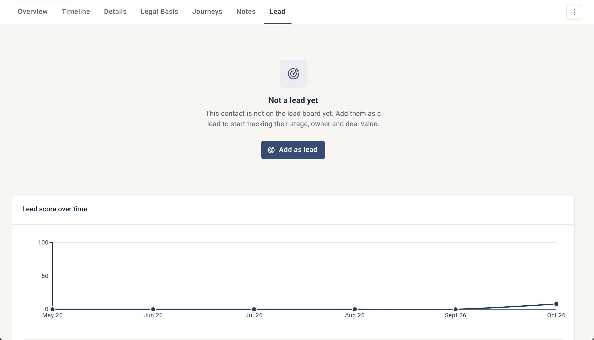
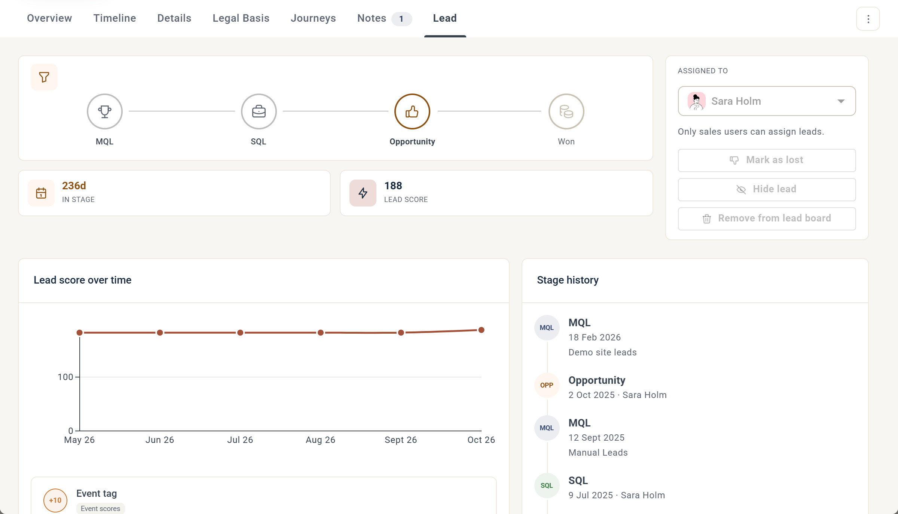

# The contact card

The contact card shows everything eMarketeer knows about a contact, and lets you act on it.

It opens wherever you click a listed contact in eMarketeer: in Contacts, on the Lead Board, in reports and anywhere else contacts are listed. This article walks through the top of the card and each of its tabs.

## The top of the card

The top of the card is the same on every tab.

1. **Photo.** Click the photo to change it. The number on the photo is the contact's lead score.
2. **Contact category.** The first label after the name. Click it to change the category to Prospect, Customer or Other in the Update Category dialog.
3. **Lead stage.** The second label shows where the contact is on the Lead Board, for example MQL or Opportunity.
4. **Tags.** Click the tag icon to choose a tag, or type a new one to create it. See [Tags](tags.md).
5. **Share.** Share the contact to your CRM, or copy a link to the contact.

Under the name you see the contact's job title and company. Click the company to see its company profile, which is researched based on the contact's email domain. The contact options below link to the contact's email address, mobile number and LinkedIn profile.

### Share

* **Share to CRM** creates a record of the contact in your connected CRM, or matches an existing record. The contact's CRM ID is then saved as the contact's [External ID](../../documentation/superoffice/superoffice-contact-matching.md#external-id). This option is shown when the contact has no External ID. When the contact has an External ID, the menu shows **Open in CRM** instead, which opens the contact in your integrated CRM.
* **Copy link to this contact** copies a link to the contact that you can send to other eMarketeer users.

The **⋮** menu to the right of the tabs has one option, **Delete this contact**.

To close the contact card, click **X** in the top right corner or press Escape.

## Overview

The Overview tab gives you a quick picture of the contact's activity and status.

A banner at the top sums up the most pressing issue or conclusion about the contact. Not every contact has a banner: it's only shown when one of these applies:

* **Delivery problem.** Email to the contact bounces, and the banner suggests that you review the email address.
* **Consent withdrawn.** The contact has withdrawn consent and won't receive your campaigns or emails.
* **Unengaged.** Email reaches the contact, but the contact isn't interacting with it.
* **Active.** The contact has been active lately, and the banner suggests that you reach out, with shortcuts to call, open LinkedIn, view the lead or send an email.

Below the banner, four tiles show the **Lead score**, the **Last activity**, how many emails the contact **opened** in the last 12 months, and the contact's stage on the **Lead Board**.

The cards below the tiles:

* **Signals & recent activity.** The latest activity and signals for the contact. Click **View all** to open the [Timeline](#timeline).
* **Reachability.** Whether the contact has given consent, has a working email address and has a mobile number. Click **Legal Basis** to open the [Legal Basis](#legal-basis) tab.
* **Active journeys.** The Journeys the contact is in right now. Click **Journeys** to open the [Journeys](#journeys) tab.
* **Company.** General information about the contact's company, researched by AI.
* **Latest note.** The most recent note from the [Notes](#notes) tab.
* **How the contact found you.** Where the contact was created, and the first and latest traffic sources. The traffic sources come from the [Web Tracker](../../documentation/web-tracker/README.md).
* **Contact lists.** The contact lists the contact belongs to.

At the bottom you see when the contact was created and last updated.

## Timeline

The Timeline tab lists everything the contact has done, in time order.

* By default, engagements are grouped by month. Use the buttons at the top right to group them by campaign instead.
* Each month shows a summary of the types of engagement that happened that month. Click a month to expand it.
* Click **More information** to see the full details of a single engagement, such as the answers in a form submission or the pages in a web session.
* Filter on **All**, **Outbound**, **Inbound** or **Signals** to find a specific type of engagement:
  * **Outbound** is the emails and SMS you have sent to the contact.
  * **Inbound** is what the contact has done, such as submitting eMarketeer forms or social media lead forms, and visiting your website.
  * **Signals** are custom signals sent through the [Custom Signals API](../../documentation/apis-developer/custom-signals-api.md).

## Details

The Details tab holds the contact's data.

* **Contact fields.** Type into a field to update the contact. The change is saved as soon as you leave the field, for example when you click somewhere else or press Tab to move to the next field.
* **Subscriptions.** Each subscription, and whether the contact can receive it. See [Subscriptions](../account-admin/subscriptions.md).
* **Record metadata.** When and how the contact was created, and the contact's External ID.

## Legal Basis

The Legal Basis tab shows the contact's legal basis for each purpose, and a change log of every update. Click **Update legal basis** to change it manually. See [How does consent work?](../gdpr-consent/how-does-consent-work.md)

## Journeys

* **Currently active.** The Journeys the contact is in right now, and the step the contact has reached. Click **X** to stop the contact from continuing in a Journey.
* **Start a Journey.** Journeys that have **Make Journey available on Contact card** enabled. Click the eye icon to preview a Journey, or **Start** to start it for the contact. See [Manual trigger](../../documentation/journeys/journeys-triggering-events.md#manual-trigger).


Removing a contact from a Journey only stops the contact from continuing. It doesn't undo what has already happened: the Journey steps the contact completed, for example in a test, still list the contact.


## Notes

The Notes tab is where you and your colleagues add notes about the contact. You can view, edit and post notes, and every note is visible to all users in the account.

## Lead

The Lead tab looks different depending on whether the contact is a lead yet.

### When the contact is not a lead

* **Add as lead** adds the contact to the Lead Board.
* **Lead score over time** is a graph of the contact's lead score, showing which lead scoring rules the contact has triggered. See [How lead scoring works](../lead-board-scoring/how-lead-scoring-works-in-emarketeer.md).

### When the contact is a lead

* **Lead stages.** Click a stage to move the lead to it.
* **In stage and lead score.** How long the lead has been in its current stage, and its lead score.
* **Assigned to.** The sales user the lead is assigned to.
* **Mark as lost**, **Hide lead** and **Remove from lead board** control the lead's place on the board.

To work with leads, for example to assign them, mark them as lost or hide them, you need a Sales User license. See [User accounts](../../documentation/accounts-auth/user-accounts.md).
* **Stage history.** A timeline of how the lead has moved through the stages.

See [The lead board](../lead-board-scoring/the-lead-board.md).
