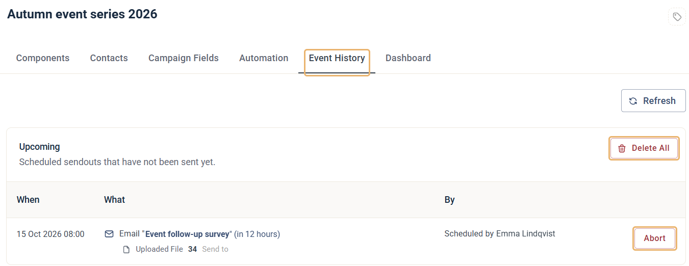
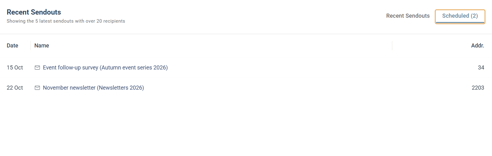

# How to abort a scheduled sendout

You can stop a scheduled email or SMS before it's sent, from the campaign's **Event History** tab.

This guide shows where to find the abort option, and how to find the sendouts you have scheduled.

## Abort a scheduled sendout

1. Open the campaign that holds the scheduled email or SMS, and click the **Event History** tab.
2. Under **Upcoming**, find the sendout. **When** shows when it will be sent. **What** shows the component and who it goes to, for example **Uploaded File 34**, so you can check the recipient composition at a glance.
3. Click **Abort** to stop that sendout. If several components are scheduled in the campaign, click **Delete All** to abort all of them.

Aborting only removes the schedule. The email or SMS stays in the campaign as it is, so you can edit it and schedule or send it again.

## Find your scheduled sendouts

If you don't remember which campaign a sendout belongs to, open **Dashboards** and go to the [Operational Report](../dashboards/operational-report.md). In the **Recent Sendouts** widget, click the **Scheduled** tab. It shows the 5 scheduled emails or SMS with the closest send dates, with the campaign name in brackets after each one.
