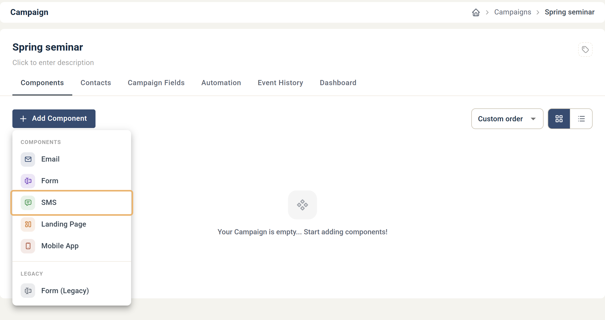
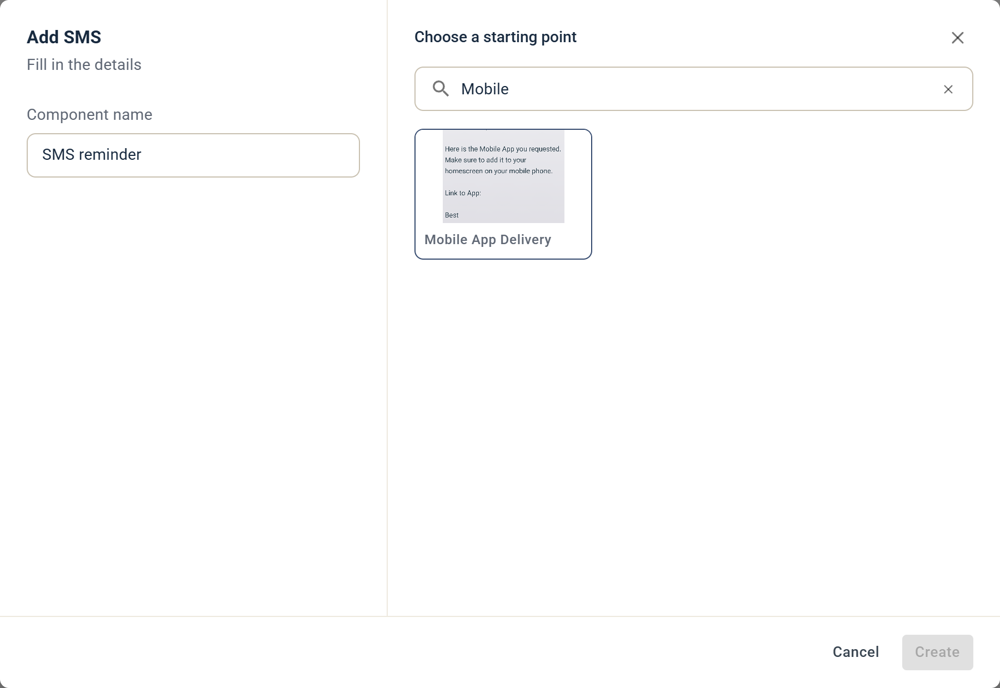
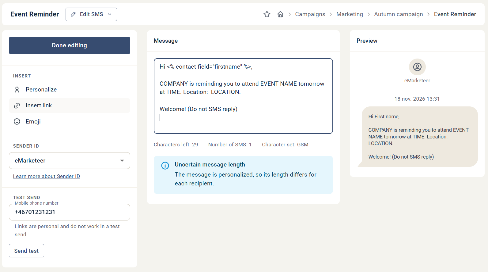

# Creating your first SMS


To create a new SMS it is required that you create a campaign first. If you don't have a campaign ready, see [How to create a new campaign](create-new-campaign.md).


This guide walks you through creating an SMS in eMarketeer — for publishing an app, notifying about an event, or any other use.

Sending SMS is only a few steps once the message is set up. By the end of this guide you will have a message ready to send.



### Add the SMS from the campaign page

From the campaign page, click **Add Component**, then **SMS**.




### Fill in settings, choose a template, create the SMS

**Settings**

* **Name your SMS:** Give the SMS a unique name so you can find it later. Describe its purpose in the campaign — for example, "Invitation" for an event invitation. Only you see this name; it is not shown to your contacts.

**Template**

Pick a template from one of the tabs as a starting point. This guide uses **Mobile App Delivery**. Custom templates saved on your account appear under **My Templates**.

**Create SMS component**

Once settings and template are set, click **Create** to create the component.



### The SMS editor

After you click **Create**, the editor opens. You write the message in the **Message** box in the middle. The **Preview** on the right shows how it looks on a phone.

The left panel holds the rest of the settings:

* **Sender ID** — the name of the sender as shown on the recipient's phone. The default is `eMarketeer`. You can request a custom Sender ID — see [this article](../../documentation/email-sms/sender-id.md).
* **Test send** — send the SMS to your own mobile phone number to see how it looks on arrival. Links in a test SMS do not work — send the SMS the normal way if you need to test links.




### Edit the SMS content

Write the message in the **Message** box. Under **Insert** in the left panel, use **Personalize** to add personalized text such as the contact's first name, **Insert link** to add a link, and **Emoji** to add an emoji.

Below the box you see how many characters are left, how many SMS the message is split into, and which character set it uses: GSM or Unicode. An emoji switches the message to Unicode. A Unicode SMS holds fewer characters, so the message may need more parts.

If the message is personalized, its length differs for each contact, so these counts are approximate.

Links to other eMarketeer components are personalized per contact. For example, if you send a link to a mobile app component for an event, it can include a unique QR code or badge the contact uses to identify themselves at the event.

Click **Done editing** to save your changes.



### Send your SMS

Sending an SMS works much like sending an email and has many of the same options. See [How to send an email](basics-send-email.md) for the full walkthrough.

Phone numbers must include the country code and follow [standard formatting](../../documentation/email-sms/mobile-number-validation.md) before you send. For example: `+46701231231`.


