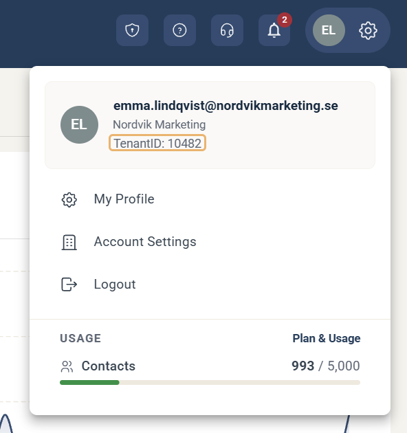
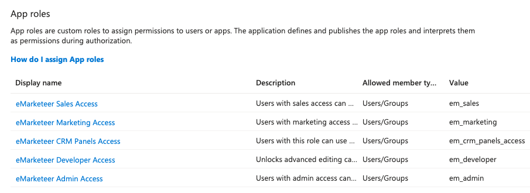

# Så aktiverar du SSO via Microsoft Entra

Med enkel inloggning (SSO) via Microsoft Entra loggar dina användare in i eMarketeer med sitt Microsoft-konto.

Första gången en användare loggar in skapar eMarketeer användaren automatiskt. De app-roller du tilldelar i Entra avgör användarens licenser och behörigheter i eMarketeer.

## Innan du börjar

SSO via Microsoft Entra är en betaltjänst med en installationskostnad och en månadsavgift. Kontakta [sales@emarketeer.com](mailto:sales@emarketeer.com) för mer information.

Du behöver tre uppgifter:

* **Ditt tenant-ID i Microsoft Entra.** Du hittar det på sidan **Overview** i Microsoft Entra ID.
* **Din e-postdomän**, till exempel `nordvikmarketing.se`. Användare med en e-postadress på den här domänen loggar in via Microsoft.
* **Ditt tenant-ID i eMarketeer.** Klicka på kugghjulsikonen uppe till höger i eMarketeer. ID:t visas som **TenantID** under ditt kontonamn.

## Aktivera SSO

1. [Kontakta eMarketeers support](../../knowledge-base/account-admin/contact-support.md) med de tre uppgifterna: ditt tenant-ID i Microsoft Entra, din e-postdomän och ditt tenant-ID i eMarketeer. Vi meddelar dig när SSO är aktiverat för ditt konto.
2. En administratör i ditt eMarketeer-konto loggar in i eMarketeer och godkänner frågan om att tillåta kopplingen.

## Tilldela app-roller

När kopplingen är tillåten läggs appen **eMarketeer Marketing Cloud** till bland dina Enterprise apps i Microsoft Entra. Tilldela användare eller grupper till appens roller för att ge dem åtkomst till eMarketeer.

1. Gå till **Entra ID** → **Enterprise apps** i Microsoft Entra admin center och öppna **eMarketeer Marketing Cloud**.
2. Öppna **Users and groups** och klicka på **Add user/group**.
3. Välj användare eller grupper, välj en roll och klicka på **Assign**.

En användare kan ha flera roller. Lägg till en tilldelning för varje roll, eller tilldela rollerna till en grupp. Ge till exempel en användare både eMarketeer Marketing Access och eMarketeer Admin Access för att göra användaren till en Marketing User med administratörsbehörighet.

Om du ändrar en användares roller i Entra gäller ändringen i eMarketeer nästa gång användaren loggar in.

### App-rollerna

| Roll | Värde | Vad användaren får i eMarketeer |
| --- | --- | --- |
| eMarketeer Marketing Access | `em_marketing` | En Marketing User-licens: kampanjer, e-post, formulär, kontakter, Journeys och rapporter. |
| eMarketeer Sales Access | `em_sales` | En Sales User-licens: Lead Board och leads. |
| eMarketeer Admin Access | `em_admin` | Behörigheten Administrator: kontoinställningar och användarhantering. |
| eMarketeer Developer Access | `em_developer` | Behörigheten Developer: den fullständiga HTML-källkoden i e-postredigeraren, landningssidor, appar och JSON-redigeraren i formulär. |
| eMarketeer CRM Panels Access | `em_crm_panels_access` | Behörigheten CRM Web panels: eMarketeer-paneler i ditt integrerade CRM. |

Se [Användarkonton](user-accounts.md) för mer om användartyper och behörigheter.

## Logga in med SSO

Användarna loggar in genom att ange sin e-postadress på eMarketeers inloggningssida. Om adressen finns på den e-postdomän du angav skickas de vidare för att logga in med Microsoft.


Om du tar bort en användare i Microsoft Entra tas användaren inte bort från eMarketeer, men användaren kan inte längre logga in.

