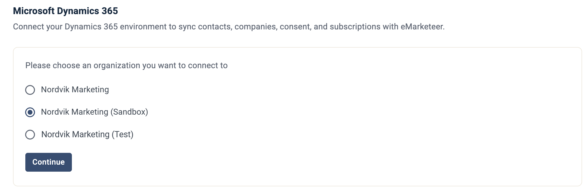

# Dynamics - Installationsprocess



### Skapa en app-användare i Power Platform-miljön

Det här steget kräver två roller på Microsoft-sidan:

- **Delsteg 1:** en Microsoft Entra-roll som kan ge administratörsmedgivande för din klientorganisation, till exempel Global Administrator, Cloud Application Administrator eller Application Administrator. Medgivandet lägger till eMarketeer-appen i din klientorganisation.
- **Delsteg 2 till 8:** rollen **System Administrator** i Power Platform-miljön. Den skapar app-användaren och tilldelar dess säkerhetsroll.

Följ dessa steg:

1. Navigera till en consent-URL och lägg till appen: `https://login.microsoftonline.com/<your tenant id>/adminconsent?client_id=a2a5e177-5102-4792-b0eb-52f4539f3cf7`
2. Öppna **Power Platform Admin Center** på `https://admin.powerplatform.microsoft.com`.
3. Gå till **Manage > Environments** och välj den miljö du konfigurerar.
4. Öppna **Settings → Users + permissions → Application users**.
5. Klicka på **+ New app user**.
6. På skärmen för appval, välj **eMarketeer Marketing Cloud**. Om den inte syns, sök med App ID `a2a5e177-5102-4792-b0eb-52f4539f3cf7`.
7. Tilldela app-användaren en säkerhetsroll. Välj **System Administrator**, eller en anpassad roll med enbart de behörigheter integrationen använder. Se [Dynamics - Obligatoriska behörigheter](dynamics-permissions.md) för hur du bygger den anpassade rollen.
8. Klicka på **Save**.


### Aktivera granskning för synkronisering av samtycke

För att säkerställa att samtyckesdata synkroniseras korrekt, aktivera granskning för Contact-tabellen.

1. Gå till Power Apps på `https://make.powerapps.com`.
2. Navigera till **Tables → Contact**.
3. Klicka på **Properties**, sedan **Advanced options**.
4. Markera **Audit changes to its data**.
5. Klicka på **Save**.



### Aktivera integrationen i eMarketeer

Det här steget kräver rollen Administrator i eMarketeer.

I eMarketeer klickar du på kugghjulsikonen uppe till höger, väljer **Account settings**, öppnar **Integrations** och klickar på **Manage** på kortet **Microsoft Dynamics 365**.

Klicka på **Connect to Dynamics 365**.

Microsoft ber dig välja ett konto. Välj ett Microsoft-konto som har åtkomst till den Dynamics-miljö du vill integrera, eller klicka på **Use another account** för att logga in med ett annat konto.

Välj den organisation (miljö) du vill integrera med och klicka på **Continue**.



