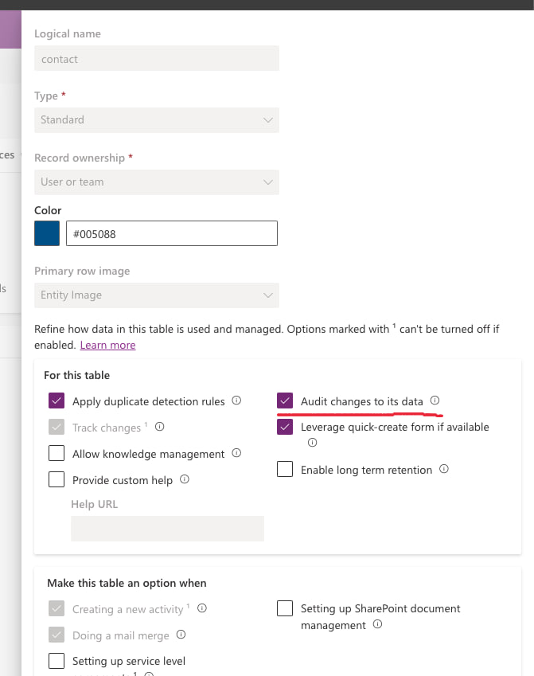
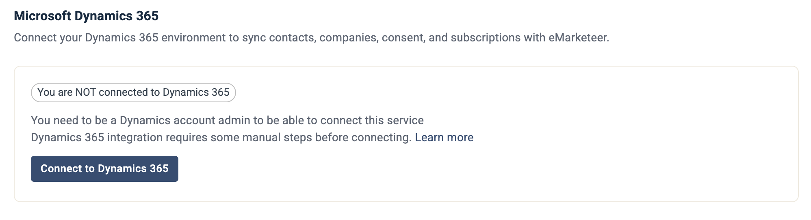
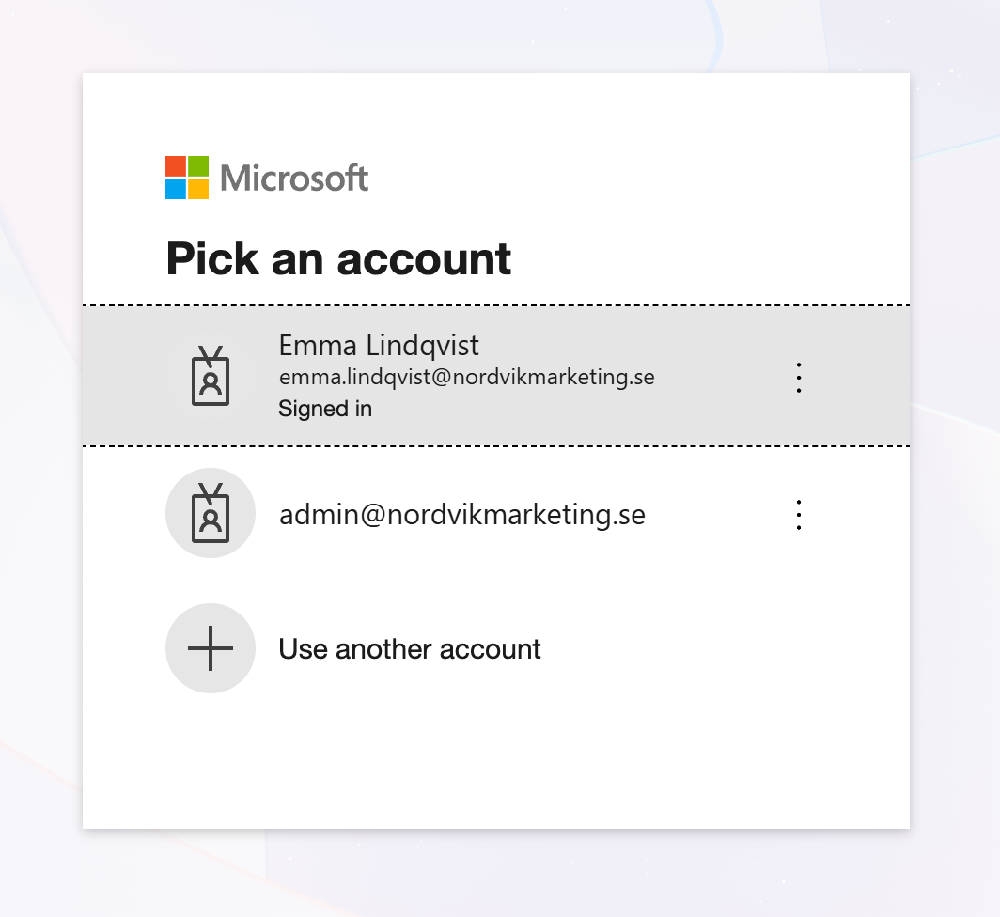

# Dynamics - Installationsprocess



### Skapa en app-användare i Power Platform-miljön

Som **System Administrator**, följ dessa steg:

1. Navigera till en consent-URL och lägg till appen: `https://login.microsoftonline.com/<your tenant id>/adminconsent?client_id=a2a5e177-5102-4792-b0eb-52f4539f3cf7`
2. Öppna **Power Platform Admin Center** på `https://admin.powerplatform.microsoft.com`.
3. Gå till **Manage > Environments** och välj den miljö du konfigurerar.
4. Öppna **Settings → Users + permissions → Application users**.
5. Klicka på **+ New app user**.
6. På skärmen för appval, välj **eMarketeer Marketing Cloud**. Om den inte syns, sök med App ID `a2a5e177-5102-4792-b0eb-52f4539f3cf7`.
7. Tilldela säkerhetsrollen **System Administrator** till app-användaren.
8. Klicka på **Save**.


### Aktivera granskning för synkronisering av samtycke

För att säkerställa att samtyckesdata synkroniseras korrekt, aktivera granskning för Contact-tabellen.

1. Gå till Power Apps på `https://make.powerapps.com`.
2. Navigera till **Tables → Contact**.
3. Klicka på **Properties**, sedan **Advanced options**.
4. Markera **Audit changes to its data**.
5. Klicka på **Save**.



### Aktivera integrationen i eMarketeer

Denna åtgärd kräver rollen Administrator.

I eMarketeer klickar du på kugghjulsikonen uppe till höger, väljer **Account Settings**, öppnar **Integrations** och klickar på **Manage** på kortet **Microsoft Dynamics 365**.

Klicka på **Connect to Dynamics 365**.

Microsoft ber dig välja ett konto. Välj ett Microsoft-konto som har åtkomst till den Dynamics-miljö du vill integrera, eller klicka på **Use another account** för att logga in med ett annat konto.

Välj den organisation (miljö) du vill integrera med och klicka på **Continue**.




## Tilldela mindre än System Administrator

App-användaren behöver inte rollen System Administrator. Om du vill ge den enbart de behörigheter integrationen använder bygger du en anpassad roll utifrån [Dynamics - Obligatoriska behörigheter](dynamics-permissions.md) och tilldelar den rollen i steg 1.

## Använd din egen appregistrering (valfritt)

Som standard tillhör app-användaren eMarketeers appregistrering, som alla eMarketeer-kunder delar. Du kan i stället använda en app som du registrerar i din egen Microsoft Entra-klientorganisation. Dess klienthemlighet ger då åtkomst enbart till din miljö. Se [Säkerhetskontroller](dynamics-permissions.md#säkerhetskontroller) för skillnaden.

1. Registrera en ny app i Microsoft Entra admin center. Välj **Accounts in this organizational directory only**.
2. Öppna **Certificates & secrets** för appen och skapa en klienthemlighet. Kopiera dess värde.
3. Följ steg 1 ovan, men välj din egen app i stället för **eMarketeer Marketing Cloud** när du skapar app-användaren.
4. Följ steg 3 ovan. När du har valt organisation aktiverar du **Use your own app registration**.
5. Ange **Application (client) ID** och **Client secret** och klicka sedan på **Continue**.

Du loggar fortfarande in med ditt Microsoft-konto via eMarketeers app i steg 3. Den inloggningen hittar bara dina miljöer. Den ger inte eMarketeer någon stående åtkomst.

Du ansvarar för klienthemlighetens giltighetstid och rotation. Skapa en ny hemlighet innan den går ut, och anslut på nytt med den.
