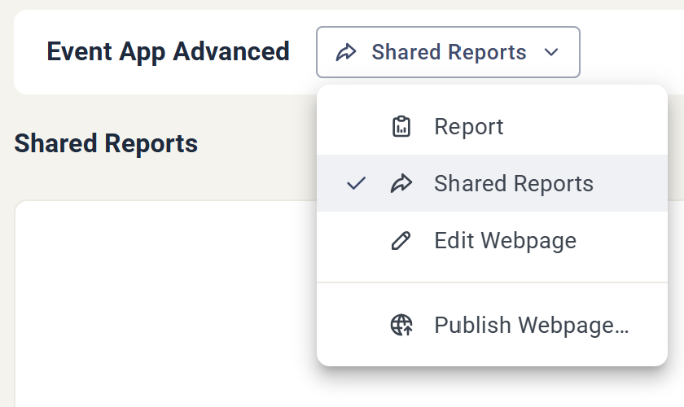
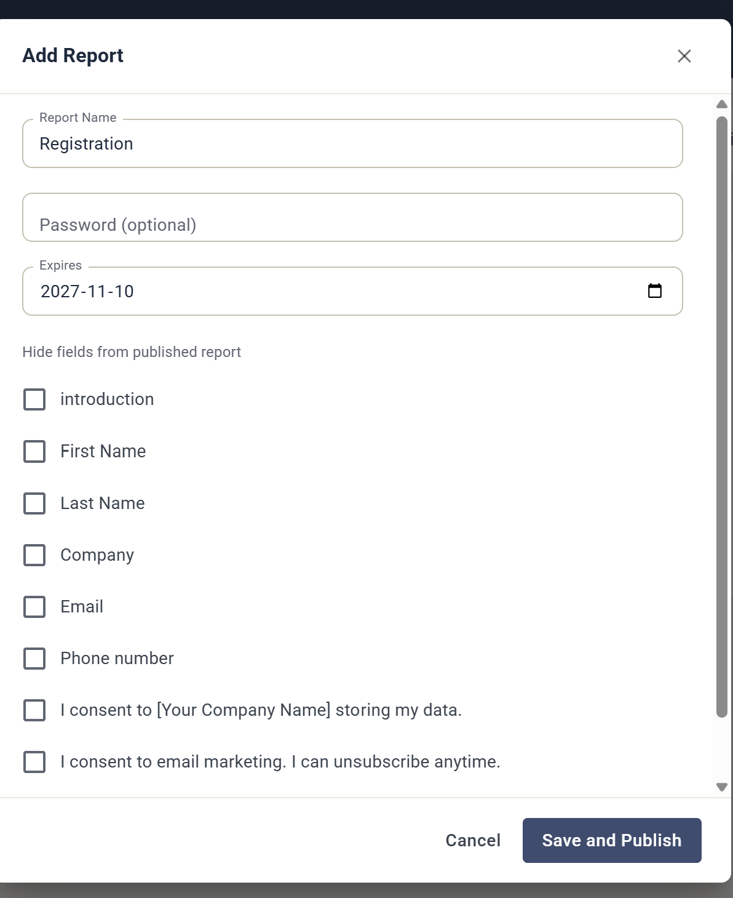

# Shared Reports

Med Shared Reports publicerar du valfri komponentrapport som en delbar URL som vem som helst kan öppna — utan inloggning i eMarketeer.

En delad rapport är live. Den uppdateras i realtid när data kommer in, så den du delar med ser alltid de aktuella siffrorna. Det gör den användbar för till exempel en deltagar- eller cateringlista inför ett event, eller för att dela siffrorna från ett nyhetsbrevsutskick med en kollega eller kund.

En delad rapport speglar eMarketeers komponentrapport, men den är inte fullt interaktiv. Av säkerhetsskäl är de åtgärder du har inne i appen begränsade i den delade vyn.

## Skapa en delad rapport

Öppna komponenten, klicka på rullgardinsmenyn bredvid komponentnamnet och välj **Shared Reports**.

I vyn Shared Reports, klicka på **Add Report**. Ge rapporten ett namn, ställ in något av alternativen nedan och klicka på **Save and Publish** för att skapa URL:en.

## Delningsalternativ

* **Password** — skydda rapporten med ett lösenord, så att bara de du ger det till kan öppna den. Valfritt.

En komponentrapport för ett formulär har två alternativ till:

* **Hide fields** — utelämna specifika fält och kontaktdata (förnamn, efternamn, företag, e-post, telefonnummer och så vidare) från den publicerade rapporten.
* **Expires** — sätt ett datum då den delade rapporten slutar vara tillgänglig.
