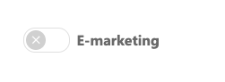

# Importera kontakter från SuperOffice CRM

I SuperOffice CRM har varje Person en "huvudströmbrytare" för e-marknadsföring på intresseflikfliken. Vi kallar denna "samtyckesbrytaren för e-marknadsföring".

Om kontakten saknar laglig grund för e-postutskick i marknadsföring är brytaren av (grå). Om kontakten har en laglig grund som tillåter e-marknadsföring är brytaren på (grön).

## Välj vilka kontakter som ska importeras

När du importerar kontakter från SuperOffice CRM till eMarketeer kan du hoppa över eller inkludera kontakter vars e-marknadsföringsbrytare är av.

* Om kryssrutan är markerad importeras endast kontakter med e-marknadsföringsbrytaren på.
* Om kryssrutan inte är markerad importeras alla kontakter i Selection eller projektet.

## Hur kontakter identifieras

Importerade kontakter identifieras i eMarketeer via sin primära e-postadress, inte via Contact ID i SuperOffice. Om e-postadressen inte redan finns i eMarketeer skapas ett nytt kontaktkort med den e-postadressen som identifierare.

Varje kontakt i eMarketeer med den e-postadressen uppdateras, och Contact ID i SuperOffice sparas som kontaktens External ID. Se [Så matchas kontakter mellan eMarketeer och SuperOffice](superoffice-contact-matching.md).

## Importerade fält

Importen fyller i följande standardfält på kontakten i eMarketeer:

* Förnamn
* Efternamn
* E-post
* Telefon
* Mobil
* Titel
* Contact ID (sparas som External ID)

Det finns ingen mappning för anpassade fält. En översikt över hur kontakter flyttas mellan eMarketeer och SuperOffice finns i [SuperOffice-integrationen – funktioner och flöden](integration-features-and-flows.md#import-och-export-av-kontakter).

### Postadress

Som standard importerar eMarketeer postadressen för kontaktens företag.

Om **Use as postal address** är markerat för kontakten i SuperOffice importerar eMarketeer i stället kontaktens egen postadress. Det är samma inställning som SuperOffice använder för att avgöra vilken adress som ska användas vid utskick.
