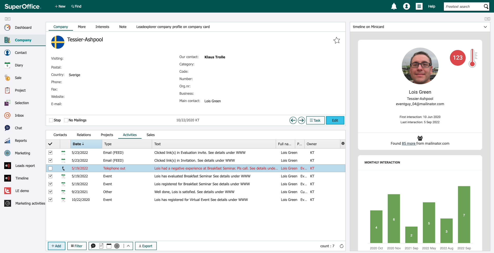

# SuperOffice-integrationen – funktioner och flöden

eMarketeer-integrationen för SuperOffice CRM kopplar marknadsaktivitet till CRM-systemet, så att sälj ser lead- och engagemangsdata utan manuell överlämning.

## Vanliga användningsfall

Integrationen används ur två perspektiv: marknad (eMarketeer-sidan) och sälj (SuperOffice CRM-sidan).

Ur ett marknadsperspektiv används integrationen oftast för att:

* Importera SuperOffice-segment (Selection) för att adressera e-postutskick.
* Använda automationer för att skicka händelser eller skapa objekt i SuperOffice CRM, till exempel:
  * Skapa en Sale.
  * Skapa Activity (öppna eller avslutade).
  * Lägga till eller ta bort kontakter från Selection eller projekt.
  * Lägga till eller ta bort intressen.

Ur ett säljperspektiv låter integrationen SuperOffice CRM-användare:

* Se information från eMarketeer om kontakterna. Automationerna ovan kan skapa en Sale, Activity eller uppgift i CRM-systemet.
* Använda Automation Queue (en webbpanel) för att granska nya kontakter från eMarketeer, och matcha dem mot befintliga kontakter eller skapa dem i SuperOffice CRM.
* Få en fullständig historik över kontaktens interaktioner med innehåll online genom eMarketeers Timeline Report.

## Integrationsgränssnitt

eMarketeer kopplas mot SuperOffice CRM via de vanliga NetServer-tjänsterna. eMarketeer använder för närvarande version 7.5 av bakåtkompatibilitetsskäl.

## Import och export av kontakter

### Separata databaser

eMarketeer och SuperOffice CRM har separata databaser, och de förblir separata även med integrationen på plats. Det finns ingen bakgrundssynkronisering av kontakter. Kontakter kopplas via External ID, se [Så matchas kontakter mellan eMarketeer och SuperOffice](superoffice-contact-matching.md). Kontakter skapas endast av integrationen i specifika scenarier:

* **I SuperOffice CRM:** eMarketeer skapar nya kontakter (och företag) på två sätt:
  * **Automation Queue:** när en automation behöver en kontakt som inte finns i SuperOffice ännu, väntar kontakten i webbpanelen Automation Queue i eMarketeer. En SuperOffice-användare granskar den där och matchar den mot en befintlig kontakt eller skapar den. Eftersom eMarketeer genererar kontakter från webben säkerställer detta manuella steg att endast giltiga kontakter når SuperOffice CRM. Se [Hur omatchade kontakter hanteras](../../knowledge-base/integrations/superoffice-automations-pro.md#hur-omatchade-kontakter-hanteras).
  * **Journeys:** SuperOffice-stegen i en Journey kan skapa saknade kontakter och företag automatiskt, om du tillåter det i stegets inställningar. Se [Skapa saknade kontakter i SuperOffice](superoffice-contact-matching.md#skapa-saknade-kontakter-i-superoffice).
* **I eMarketeer:** nya kontakter skapas när du [importerar kontakter från SuperOffice CRM](import-contacts-from-superoffice-crm.md). Detta görs vanligen vid utskick till en SuperOffice-Selection eller ett projekt.

### Fält

Kontakter överförs med en fast uppsättning standardfält, som listas i [Importera kontakter från SuperOffice CRM](import-contacts-from-superoffice-crm.md#importerade-fält). Samma fält fylls i när eMarketeer skapar kontakter i SuperOffice.

När eMarketeer skapar företag i SuperOffice fylls följande fält i på företagskortet:

* Företagsnamn
* Land
* Kategori
* Bransch

Det finns ingen mappning för anpassade fält. Utöver standardfälten kan automationer lägga till eller ta bort intressen från kontakter.

## Automationer

När kontakter interagerar med eMarketeer via e-post, formulär, appar och så vidare kan automationer utföra uppgifter i både eMarketeer och SuperOffice CRM. De triggas av åtgärder som länkklick, formulärinskick och e-poståpningar.

När en automation körs kan eMarketeer utföra följande åtgärder i SuperOffice CRM:

* Skapa en ny Sale.
* Skapa en uppgift (öppen Activity).
* Notifiera en säljare (avslutad Activity).
* Lägga till eller ta bort en kontakt från en Selection eller ett projekt.
* Lägga till eller ta bort ett intresse från en kontakt.

Dessa Activity har lagts till i SuperOffice av automationer från eMarketeer.

## Webbpaneler

Webbpaneler visar ytterligare information eller utökar eMarketeer-funktioner in i SuperOffice CRM. De kan visas eller döljas baserat på SuperOffice-användarens grupp. Följande webbpaneler används i SuperOffice för att interagera med eMarketeer.

* Automation Queue. Listar kontakter vars automationer väntar på en matchning i SuperOffice. En automation som skapar en Sale kan till exempel bara köras när kontakten finns i SuperOffice. Tills dess väntar kontakten i Automation Queue, där sälj matchar den mot en befintlig kontakt eller skapar den.
* Timeline Report. En webbpanel på Person-kortet i SuperOffice CRM. Den visar alla interaktioner kontakten har haft med eMarketeers marknadsinnehåll, inklusive e-post, formulär, SMS och landningssidor.
* Event details. När eMarketeer skapar en Sale eller en Activity visar denna panel den händelse som triggade den.

Lär dig mer om dina kontakter och hur de har engagerat sig i ditt marknadsinnehåll.

Det är här alla kontakter som ännu inte finns i SuperOffice listas.

## Laglig grund (GDPR)

eMarketeer har ett eget system för att lagra laglig grund (kontaktsamtycken och så vidare). När integrationen körs mot SuperOffice Online synkroniseras laglig grund automatiskt mellan systemen. För on-premise-installationer av SuperOffice finns ingen synkroniseringstjänst, men du kan komma åt eMarketeers databas för laglig grund via API.
