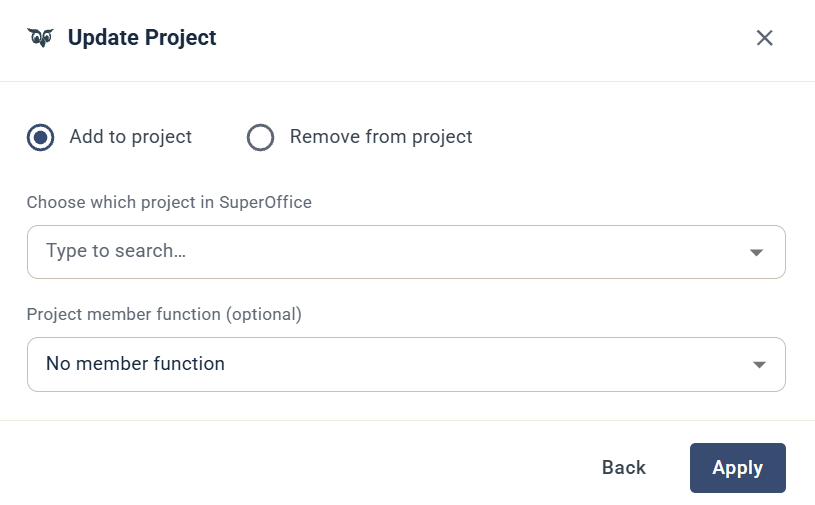

# Lägg till / Ta bort från projekt

Lägger till eller tar bort en kontakt från ett projekt i SuperOffice.

## Inställningar

Steget öppnar dialogen **Update Project**. Välj **Add to project** eller **Remove from project**.

**Choose which project in SuperOffice:** Sök efter ett projekt i ditt anslutna SuperOffice-konto och välj det.

**Project member function (optional):** Gäller bara **Add to project**. Anger kontaktens funktion i projektet, till exempel Invited, Registered eller Attended. Du väljer bland de funktioner som är uppsatta för projektet i SuperOffice. Om du lämnar **No member function** valt ändras inte kontaktens funktion. Om kontakten redan finns i projektet uppdateras funktionen. Senare steg i Journeyn kan då flytta kontakten från Invited till Registered till Attended.
