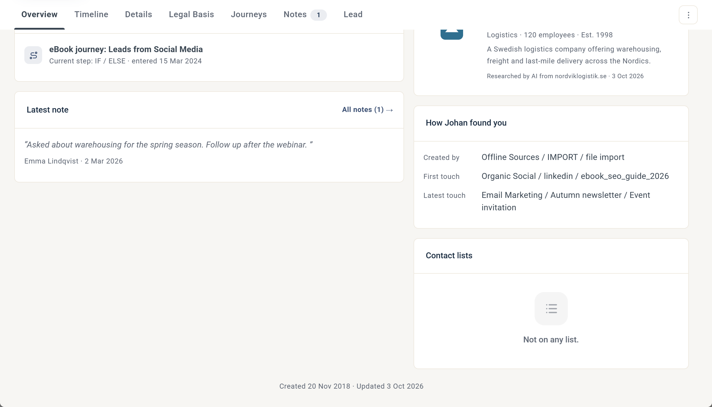
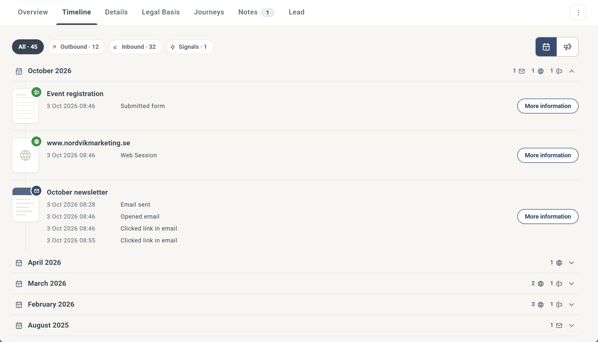
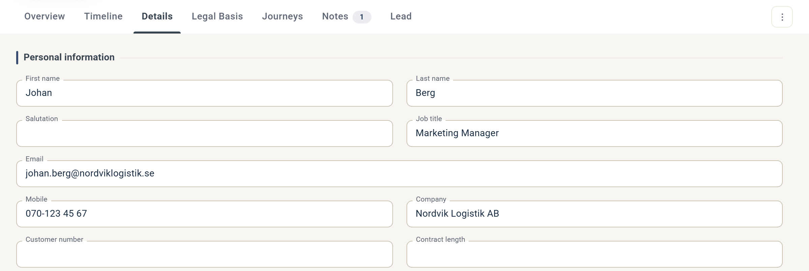
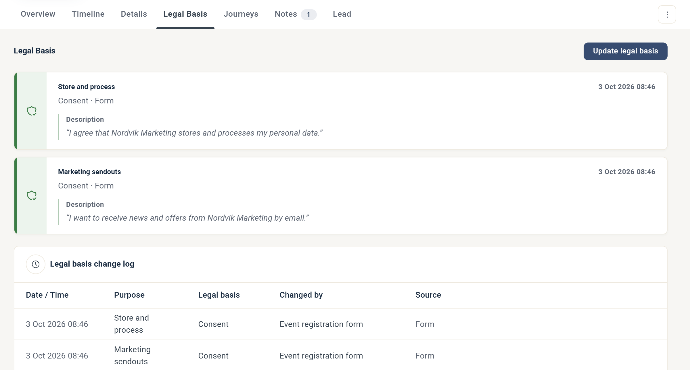
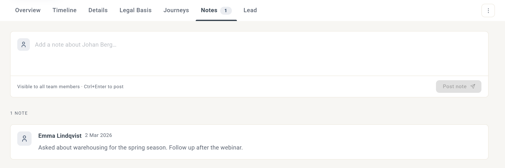

# Kontaktkortet

Kontaktkortet visar allt eMarketeer vet om en kontakt och låter dig agera på det.

Det öppnas var du än klickar på en kontakt i en lista i eMarketeer: i Contacts, på Lead Board, i rapporter och överallt där kontakter listas. Den här artikeln går igenom kortets övre del och var och en av flikarna.

## Kortets övre del

Den övre delen ser likadan ut på alla flikar.

1. **Foto.** Klicka på fotot för att byta det. Siffran på fotot är kontaktens lead score.
2. **Kontaktkategori.** Den första etiketten efter namnet. Klicka på den för att ändra kategorin till Prospect, Customer eller Other i dialogen Update Category.
3. **Leadsteg.** Den andra etiketten visar var kontakten befinner sig på Lead Board, till exempel MQL eller Opportunity.
4. **Taggar.** Klicka på taggikonen för att välja en tagg, eller skriv en ny för att skapa den. Se [Taggar](tags.md).
5. **Dela.** Dela kontakten till ditt CRM eller kopiera en länk till kontakten.

Under namnet ser du kontaktens jobbtitel och företag. Klicka på företaget för att se företagsprofilen, som tas fram utifrån kontaktens e-postdomän. Kontaktvägarna nedanför länkar till kontaktens e-postadress, mobilnummer och LinkedIn-profil.

### Dela

* **Share to CRM** skapar en post för kontakten i ditt anslutna CRM, eller matchar en befintlig post. Kontaktens ID i CRM:et sparas sedan som kontaktens [External ID](../../documentation/superoffice/superoffice-contact-matching.md#external-id). Alternativet visas när kontakten saknar External ID. När kontakten har ett External ID visar menyn **Open in CRM** i stället, som öppnar kontakten i ditt integrerade CRM.
* **Copy link to this contact** kopierar en länk till kontakten som du kan skicka till andra användare i eMarketeer.

Menyn **⋮** till höger om flikarna har ett alternativ, **Delete this contact**.

Stäng kontaktkortet genom att klicka på **X** uppe till höger eller trycka på Escape.

## Overview

Fliken Overview ger dig en snabb bild av kontaktens aktivitet och status.

En banner högst upp sammanfattar det viktigaste problemet eller den viktigaste slutsatsen om kontakten. Alla kontakter har inte en banner: den visas bara när något av följande gäller:

* **Leveransproblem.** Mejl till kontakten studsar, och bannern föreslår att du ser över e-postadressen.
* **Återkallat samtycke.** Kontakten har återkallat sitt samtycke och får inte dina kampanjer eller mejl.
* **Oengagerad.** Mejlen når kontakten, men kontakten interagerar inte med dem.
* **Aktiv.** Kontakten har varit aktiv på sistone, och bannern föreslår att du hör av dig, med genvägar för att ringa, öppna LinkedIn, visa leadet eller skicka ett mejl.

Under bannern visar fyra rutor kontaktens **Lead score**, **Last activity**, hur många mejl kontakten har **öppnat** de senaste 12 månaderna och kontaktens steg på **Lead Board**.

Korten under rutorna:

* **Signals & recent activity.** Kontaktens senaste aktiviteter och signaler. Klicka på **View all** för att öppna [Timeline](#timeline).
* **Reachability.** Om kontakten har gett samtycke, har en fungerande e-postadress och har ett mobilnummer. Klicka på **Legal Basis** för att öppna fliken [Legal Basis](#legal-basis).
* **Active journeys.** De Journeys som kontakten är med i just nu. Klicka på **Journeys** för att öppna fliken [Journeys](#journeys).
* **Company.** Allmän information om kontaktens företag, framtagen av AI.
* **Latest note.** Den senaste anteckningen från fliken [Notes](#notes).
* **Hur kontakten hittade dig.** Var kontakten skapades, samt den första och den senaste trafikkällan. Trafikkällorna kommer från [Web Tracker](../../documentation/web-tracker/README.md).
* **Contact lists.** De kontaktlistor som kontakten finns i.

Längst ned ser du när kontakten skapades och senast uppdaterades.

## Timeline

Fliken Timeline listar allt kontakten har gjort, i tidsordning.

* Som standard grupperas engagemangen per månad. Använd knapparna uppe till höger för att gruppera dem per kampanj i stället.
* Varje månad visar en sammanfattning av vilka typer av engagemang som skedde den månaden. Klicka på en månad för att fälla ut den.
* Klicka på **More information** för att se alla detaljer om ett enskilt engagemang, till exempel svaren i en formulärinskickning eller sidorna i en webbsession.
* Filtrera på **All**, **Outbound**, **Inbound** eller **Signals** för att hitta en viss typ av engagemang:
  * **Outbound** är de mejl och SMS du har skickat till kontakten.
  * **Inbound** är det kontakten har gjort, till exempel skickat in formulär i eMarketeer eller leadformulär i sociala medier, och besökt din webbplats.
  * **Signals** är anpassade signaler som skickas via [Custom Signals API](../../documentation/apis-developer/custom-signals-api.md).

## Details

Fliken Details innehåller kontaktens uppgifter.

* **Kontaktfält.** Skriv i ett fält för att uppdatera kontakten. Ändringen sparas så fort du lämnar fältet, till exempel när du klickar någon annanstans eller trycker på Tab för att gå till nästa fält.
* **Prenumerationer.** Varje prenumeration och om kontakten kan ta emot den. Se [Prenumerationer](../account-admin/subscriptions.md).
* **Metadata för posten.** När och hur kontakten skapades, samt kontaktens External ID.

## Legal Basis

Fliken Legal Basis visar kontaktens rättsliga grund för varje syfte och en ändringslogg över varje uppdatering. Klicka på **Update legal basis** för att ändra den manuellt. Se [Hur fungerar samtycke?](../gdpr-consent/how-does-consent-work.md)

## Journeys

* **Currently active.** De Journeys som kontakten är med i just nu, och det steg kontakten har nått. Klicka på **X** för att ta bort kontakten från en Journey.
* **Start a Journey.** Journeys som har inställningen **Make Journey available on Contact card** påslagen. Klicka på ögonikonen för att förhandsvisa en Journey, eller på **Start** för att starta den för kontakten. Se [Manuell utlösare](../../documentation/journeys/journeys-triggering-events.md#manuell-utlösare).

## Notes

På fliken Notes lägger du och dina kollegor till anteckningar om kontakten. Du kan visa, redigera och publicera anteckningar, och varje anteckning syns för alla användare i kontot.

## Lead

Fliken Lead ser olika ut beroende på om kontakten är ett lead ännu.

### När kontakten inte är ett lead

* **Add as lead** lägger till kontakten på Lead Board.
* **Lead score over time** är ett diagram över kontaktens lead score, som visar vilka regler för lead scoring som kontakten har utlöst. Se [Så fungerar lead scoring](../lead-board-scoring/how-lead-scoring-works-in-emarketeer.md).

### När kontakten är ett lead

* **Leadsteg.** Klicka på ett steg för att flytta leadet dit.
* **Tid i steget och lead score.** Hur länge leadet har varit i sitt nuvarande steg, och dess lead score.
* **Assigned to.** Säljanvändaren som leadet är tilldelat.
* **Mark as lost**, **Hide lead** och **Remove from lead board** styr leadets plats på tavlan.

För att arbeta med leads, till exempel tilldela dem, markera dem som förlorade eller dölja dem, behöver du en licens för Sales User. Se [Användarkonton](../../documentation/accounts-auth/user-accounts.md).
* **Stage history.** En tidslinje över hur leadet har rört sig genom stegen.

Se [Lead Board](../lead-board-scoring/the-lead-board.md).
