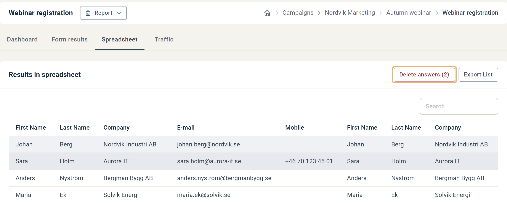
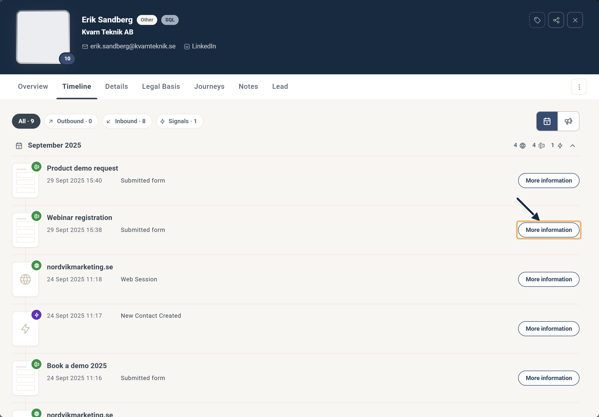
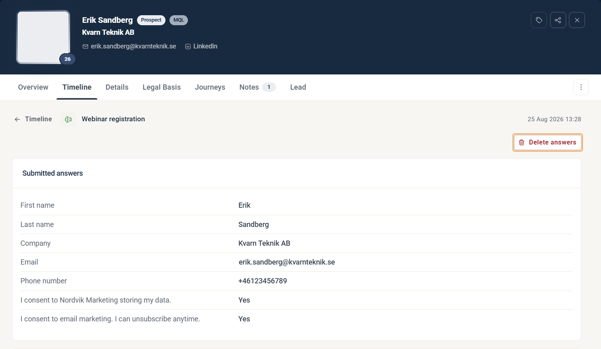
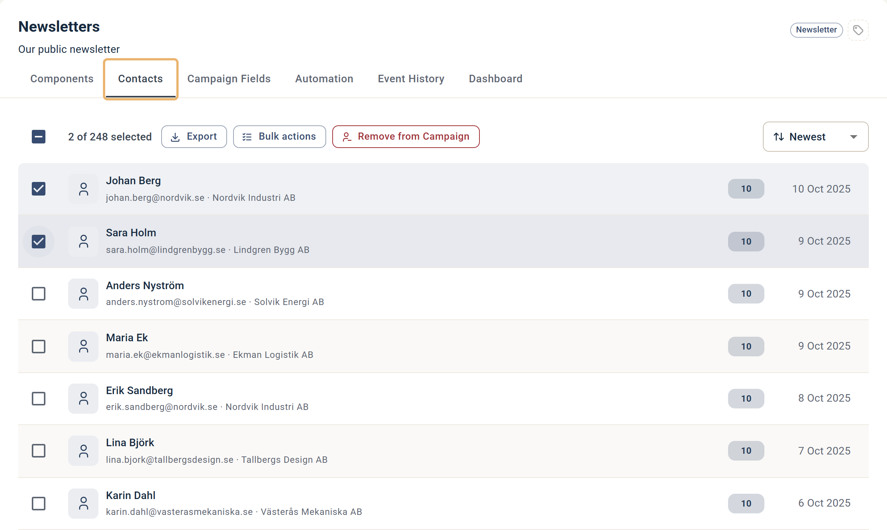

# Så tar du bort ett formulärsvar

Ta bort testsvar, felaktiga svar eller hela uppsättningen svar från en formulärrapport.

När du tar bort ett formulärsvar försvinner det från formulärrapporten och från kontaktens tidslinje. Kontakten matchar inte längre segment som bygger på den formulärinlämningen, som om kontakten aldrig hade skickat in formuläret. Kontaktfält och rättslig grund som inlämningen uppdaterade ligger kvar som de är.

Det finns tre sätt att ta bort oönskade formulärsvar, beroende på var du startar.

## Ta bort från Spreadsheet-rapporten

Öppna formulärrapporten och gå till fliken Spreadsheet. Varje rad innehåller kontaktdata och svaren från en kontakt.

1. Klicka på **⋯** i början av raden du vill ta bort.
2. Klicka på **Delete**.
3. Klicka på **Delete** igen för att bekräfta.

### Formulär (Legacy)

I Spreadsheet-rapporten för ett legacy-formulär markerar du en eller flera rader. Knappen Delete answers aktiveras, med det valda antalet visat inom parentes.

Spreadsheet-rapport med två rader markerade.

## Ta bort från kontaktkortet

Hitta kontakten på det sätt du föredrar — sökrutan för kontakter, ett filter eller genom att gå in i en komponentrapport. Öppna kontaktkortet och gå till fliken Timeline. Hitta formulärinlämningen du vill ta bort, klicka på More information och klicka sedan på Delete answers.

Hitta formulärinlämningen i tidslinjen och klicka på More information.

Delete answers tar bort kontakten från rapporten.

## Ta bort från fliken Campaign Contacts

Använd det här alternativet när du vill ta bort en kontakt från flera komponentrapporter samtidigt. Gå till fliken Contacts i kampanjen, bläddra eller sök efter kontakten, kryssa i rutan bredvid en eller flera kontakter och klicka på Remove from Campaign.

Att ta bort en kontakt från kampanjens kontakter tar bort kontakten från alla kampanjrapporter.
